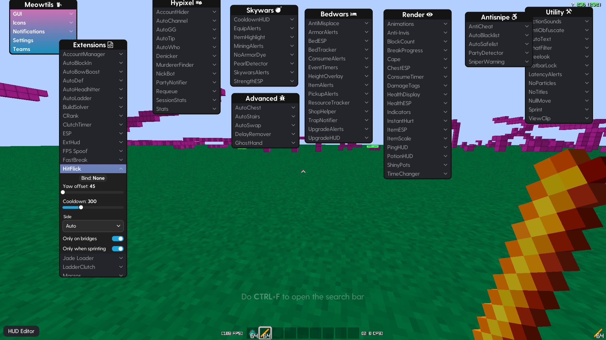

# ⚔️ HitFlick for Meowtils (Minecraft 1.8.9)

**HitFlick** is a highly optimized, completely silent Knockback Displacement extension built for the Meowtils framework on Lunar Client (1.8.9). It empowers players to manipulate their attack knockback direction, strategically flicking opponents into the void without requiring any client-side camera movement or Mixins.

## ✨ Key Features

* **🛡️ Anti-Cheat Bypass (Zero Rubberbanding):** Traditional knockback modifiers spam `C05PacketPlayerLook` packets, triggering `S08` position corrections (lagbacks) on strict servers. HitFlick elegantly bypasses this by sending a single spoofed packet and using **Java Reflection** to update `EntityPlayerSP.lastReportedYaw`. This tricks the vanilla client into seamlessly restoring the server yaw on its next natural movement tick, cutting packet footprints in half.

* **🧠 Smart 3D Void Detection:** Doesn't just blindly check the block below the target. It calculates the exact physics trajectory vector (0.4 base knockback + 0.5 sprint bonus) and samples multiple blocks ahead (up to 2 blocks horizontally and 5 blocks down) to guarantee a successful void flick, even handling close-range elevation differences.

* **⚖️ Symmetric Physics:** Knockback vectors are calculated based on the opponent's true bearing rather than your crosshair offset. This ensures that left and right flicks deliver the exact same knockback magnitude.

* **🔄 Dynamic Auto-Flip:** When fighting on narrow, exposed bridges with void on both sides, the algorithm automatically alternates flick directions (left, right, left) to mimic legitimate, unpredictable gameplay.

* **🥷 100% Silent Execution:** Operates entirely in the background via event hooks. No chat spam, no debug logs, and strictly no Mixin injections.

## 🚀 Installation

1. Go to the [Releases](../../releases) page and download the latest `HitFlick.meowtils` file.

2. Navigate to your Meowtils extensions directory:

   * **Windows:** `%appdata%\.minecraft\meowtils\extensions\`

3. Drop the `HitFlick.meowtils` file into the folder.

4. Launch Lunar Client (1.8.9) and type `/reload` in-game to load the extension.

5. Open the Meowtils GUI (Right Shift), find **HitFlick** in the Extensions tab, and configure your settings.

## ⚙️ Configuration (GUI)

* **Yaw Offset:** Controls the angle of the flick displacement.

* **Cooldown (ms):** Delay between flicks to prevent anti-cheat flags from spam-clicking (Default: 300ms).

* **Side:** Choose the flick direction (`Left`, `Right`, or `Auto`).

* **Only on bridges:** Restricts activation to scenarios where the calculated trajectory confirms the target will fall into the void.

* **Only when sprinting:** Enforces realistic 1.8.9 knockback physics requirements.

## 🛠️ Building from Source

This project is built using standard Java 8 targeting Minecraft 1.8.9 mappings.

1. Clone the repository.

2. Compile `HitFlick.java` and `Main.java`.

3. Package the `.class` files into a `.zip` archive alongside the `META-INF/meowtils.extension` file.

4. Rename the archive extension from `.zip` to `.meowtils`. (Alternatively, use the provided `build.ps1` or `build.sh` scripts).

*Disclaimer: This extension is intended for educational purposes and private practice servers. Use responsibly.*
